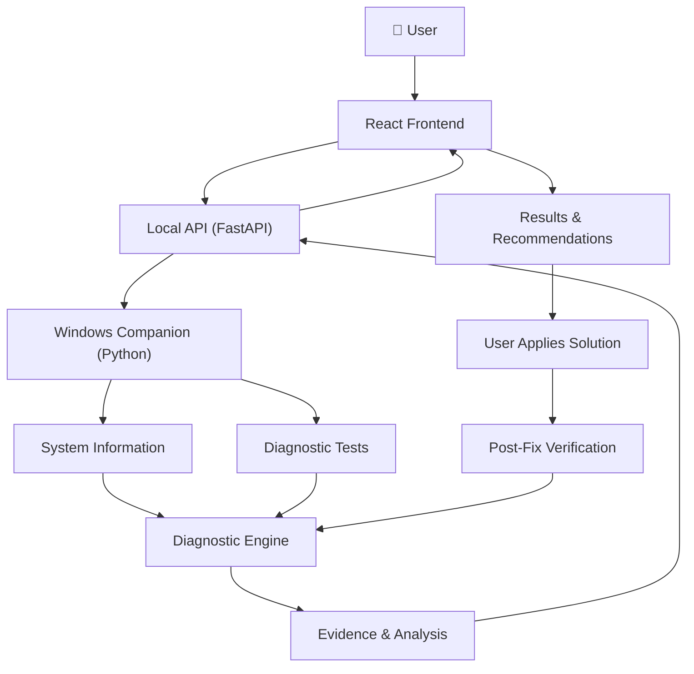

<div align="center">

# 🔧 FixIt
### Intelligent Windows PC Diagnostics & Troubleshooting

**Understand your PC. Investigate problems. Verify solutions.**

[](#)
[](#roadmap)
[](#tech-stack)
[](#tech-stack)

[Overview](#-what-is-fixit) • [Features](#-features) • [Architecture](#️-architecture) • [Tech Stack](#-tech-stack) • [Roadmap](#️-roadmap) • [Security](#-security--reliability)

</div>

---

## 📌 What is FixIt?

**FixIt** is an evidence-based Windows PC diagnostic and troubleshooting platform that helps users understand *what* is wrong with their computer, *why* it is happening, and *whether* a fix actually worked.

When a PC slows down, overheats, drains battery, or crashes randomly, users are usually stuck juggling multiple utilities, decoding cryptic logs, and following generic advice without knowing if it helped. FixIt unifies the entire workflow:

> **Understand** → **Investigate** → **Diagnose** → **Resolve** → **Verify**

---

## ✨ How an Investigation Works

Instead of replying *"Have you tried restarting?"* when a user reports *"My laptop has suddenly become very slow"*, FixIt runs a structured investigation:

1. **Collect** relevant real-time system telemetry.
2. **Examine** CPU, RAM, disk, and process utilization.
3. **Identify** unusual resource consumption or hardware anomalies.
4. **Run** targeted diagnostic checks based on the symptom.
5. **Explain** likely root causes backed by actual measurements.
6. **Guide** the user through safe, step-by-step corrective actions.
7. **Verify** the fix by re-running checks and comparing before-and-after metrics.

---

## 🚀 Features

### 🖥️ 1. System Health Dashboard
A unified live overview of CPU, RAM, storage, battery health, hardware specs, and available temperature sensors.

### 🔍 2. Symptom-Based Investigation
Report issues in plain English or pick a category:

| Category | Example Problem | Priority |
| :--- | :--- | :---: |
| **Performance** | *"My laptop has become slow"* | High |
| **Storage** | *"My disk is behaving unusually"* | High |
| **Battery** | *"Battery drains unusually quickly"* | High |
| **Temperature** | *"My laptop overheats"* | Medium |
| **Stability** | *"My computer crashes randomly"* | Medium |

### 🧠 3. Intelligent Diagnostic Engine
Selects relevant tests based on symptoms, collects real measurements, assigns confidence levels, and explains *why* a cause is suspected.

### 🛠️ 4. Guided Troubleshooting
Provides probable causes, supporting evidence, step-by-step instructions, and clear safety warnings before any action is taken.

### 🔄 5. Post-Fix Verification
Re-runs diagnostic checks after a fix is applied, compares before-and-after data, highlights improvements or remaining issues, and logs the result.

### 📊 6. Diagnostic History
Stores past investigations, test results, recommendations, and verification outcomes locally for future reference.

---

## 🏗️ Architecture

FixIt uses a three-part local architecture so the web interface can safely inspect real Windows hardware and logs.



| Component | Responsibility |
| :--- | :--- |
| **React Frontend** | Interactive dashboard, symptom reporting, and visual reports |
| **Python Companion** | Reads supported Windows hardware metrics, processes, and logs |
| **FastAPI** | Structured, controlled local API between frontend and companion |
| **Diagnostic Engine** | Test selection, evidence analysis, and confidence scoring |
| **SQLite** | Lightweight local storage for diagnostic history and records |

<details>
<summary><strong>🔎 Why a desktop companion instead of a normal website?</strong></summary>

Browsers are sandboxed and cannot inspect hardware sensors, running processes, or Windows event logs. By running a lightweight local Python companion that exposes only necessary endpoints over a local FastAPI server, FixIt interacts with the user's real machine safely and transparently.

</details>

---

## 🧰 Tech Stack

| Technology | Purpose |
| :--- | :--- |
| **React** (JS / TS) | Component-based, responsive user interface |
| **Python** | Windows companion and diagnostic engine logic |
| **FastAPI** | Fast, structured local API communication |
| **psutil** | Cross-platform CPU, RAM, disk, and process telemetry |
| **Windows APIs / PowerShell** | Windows-specific sensors, battery, and reliability logs |
| **SQLite** | Local database for investigation history |
| **Chart.js** | Live system metrics and before/after visualizations |

<details>
<summary><strong>📂 Planned Project Structure</strong></summary>

```text
FixIt/
├── frontend/
│   ├── public/
│   └── src/
│       ├── components/
│       ├── pages/
│       ├── services/
│       ├── hooks/
│       └── styles/
├── companion/
│   ├── collectors/
│   ├── diagnostics/
│   ├── windows/
│   ├── services/
│   └── main.py
├── backend/
│   ├── api/
│   ├── engine/
│   ├── models/
│   ├── database/
│   └── main.py
├── docs/
│   ├── architecture.md
│   ├── diagnostics.md
│   └── safety.md
├── tests/
├── .gitignore
├── README.md
└── LICENSE
```

</details>

---

## 🗺️ Roadmap

FixIt is being built incrementally—focusing on a reliable, evidence-based MVP first.

### Phase 1 — Foundation & MVP
- [x] Finalise requirements and system architecture
- [x] Set up GitHub repository and project workspace
- [ ] Build React frontend & System Health Dashboard
- [ ] Set up Python Windows companion & FastAPI bridge
- [ ] Implement initial diagnostic checks (CPU, RAM, Disk, Battery)
- [ ] Add symptom-based investigation & evidence display
- [ ] Implement Post-Fix Verification & SQLite history

### Phase 2 — Intelligent Diagnostics
- [ ] Expand diagnostic coverage (Temperature, Windows Stability logs)
- [ ] Introduce evidence-based confidence scoring
- [ ] Detect recurring system issues & generate exportable reports

### Phase 3 — Product Maturity
- [ ] Add user-approved automated fixes & background monitoring
- [ ] Harden permissions and local API security
- [ ] Package as a standalone Windows installer

---

## 🔐 Security & Reliability

Because FixIt interacts with live system data, safety is non-negotiable:

- **Real data only:** Never fabricate measurements; clearly flag unsupported hardware sensors.
- **Explicit user approval:** No silent file deletions, registry edits, or system changes.
- **Least privilege:** Request only the minimum Windows permissions required.
- **Local-first privacy:** All diagnostic telemetry and history stay on the user's machine by default.
- **Honest verification:** Never mark an issue as resolved without before-and-after proof.

---

## 📸 Screenshots & Demo

*Screenshots and demo walkthroughs will be added as the MVP UI takes shape.*

<details>
<summary><strong>🖥️ Planned Interface Sections</strong></summary>

| Section | Purpose |
| :--- | :--- |
| **Home Dashboard** | Live overview of system health |
| **New Investigation** | Report a problem in natural language or by category |
| **Diagnostics** | View active tests and collected evidence |
| **Recommendations** | Review step-by-step corrective actions |
| **Verification** | Compare before-and-after measurements |
| **History** | Browse past investigations and outcomes |

</details>

---

<div align="center">

**FixIt — Understand. Investigate. Verify.**  
*Not just another system monitor. Not just another AI chatbot. A structured diagnostic process built around your actual PC.*

</div>